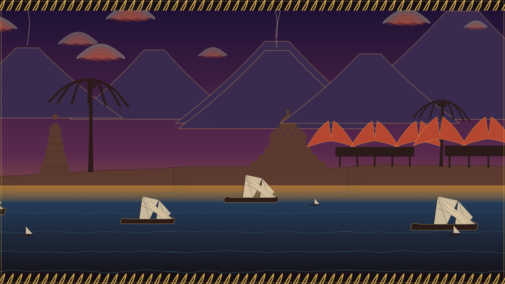

# Unlimited Indonesian Art — *Seni Nusantara Tak Terbatas*

A procedurally generated, **infinitely scrolling** artwork of Indonesian heritage,
inspired by [LingDong's *shan-shui-inf*](https://github.com/LingDong-/shan-shui-inf).
Where *shan-shui-inf* paints an endless Chinese mountains-and-water scroll, this
paints an endless **Nusantara coastline**: volcanic *gunung* under *mega mendung*
batik clouds, *candi* temples and *rumah gadang* along the shore, the *gunungan*
that opens a wayang play, and *kapal pinisi* sailing the sea — all drawn as SVG,
deterministic from a seed, and downloadable as a crisp `.svg`.

**Live:** https://art.mukhayyar.my.id



## Features

- **Infinite & deterministic.** The world is generated in chunks from one seed
  (Mulberry32 PRNG + Perlin/fBm terrain), so the same seed always paints the same
  scroll and you can pan forever in either direction.
- **Pure SVG, framework-free.** No build step, no dependencies — open `index.html`.
- **Download any view** as a standalone, editable `.svg`.
- **Two palettes:** *Senja* (a wayang-kelir dusk — indigo night to warm gold
  horizon, sogan-brown silhouettes with a blencong-lamp rim-light) and *Siang*
  (a bright batik day).

## The heritage it draws on

Motifs are inspired by Indonesia's UNESCO-recognised cultural heritage:

| Element | | Depicted as |
|---|---|---|
| **Batik** | — | the *parang rusak* border frame, *kawung*-like cloud shading, *mega mendung* clouds |
| **Wayang Kulit** (2003) | shadow play | the *gunungan / kayon* silhouettes and the backlit kelir aesthetic |
| **Keris** (2008) | forged blade | wavy silhouette accents |
| **Angklung** (2010) | bamboo music | bamboo/palm groves |
| **Tari Saman** (2011) | Gayo dance | — |
| **Noken** (2012) | Papuan bag | — |
| **Three Genres of Balinese Dance** (2015) | — | — |
| **Gamelan** (2021) | ensemble | pavilion motifs |
| **Pencak Silat** (2019) | martial art | figure silhouettes |
| **Pantun** (2020) | oral verse | — |
| **Kapal Pinisi** (2017) | Sulawesi schooner | the seven-sailed ships on the sea |

*(Some are represented directly, others evoked; contributions that add more
motifs — a Saman dance frieze, a Noken pattern, a gamelan pavilion — are welcome.)*

## Run locally

```bash
git clone https://github.com/mukhayyar/unlimited-indonesian-art
cd unlimited-indonesian-art
python3 -m http.server 8000   # or any static server
# open http://localhost:8000
```

## How it works

```
js/prng.js    seeded Mulberry32 PRNG + Perlin/fBm noise (determinism)
js/brush.js   SVG string builders + the colour palettes
js/motifs.js  heritage generators: gunung, megaMendung, candi, rumahGadang,
              pohonKelapa, gunungan, pinisi, perahu, matahari, burung
js/world.js   chunked infinite layout (sky · volcanoes · coastline · sea) + batik frame
js/app.js     viewport, pan/auto-scroll, palette, and SVG export
```

Each chunk `c` is seeded from `hash(seed, c)`, so chunks are independent yet
reproducible; the coastline uses continuous fBm over world-x, so chunk seams are
invisible.

## Credits

- Concept & engine inspired by **Lingdong Huang — [shan-shui-inf](https://github.com/LingDong-/shan-shui-inf)** (an infinite procedural *shan shui*).
- Built by **Muhammad Tsaqif Mukhayyar**.

## License

MIT — see [LICENSE](LICENSE).

## Galleries (v2 — line art)

The site is now **five infinite line-art galleries**, each its own seeded generator,
switchable in the top-right (deep-link with `?g=<id>`):

- **Gunung** — volcanic landscape: brush volcanoes, scroll-clouds, palms.
- **Candi** — temple hills: Borobudur & Prambanan in contour line art.
- **Bahari** — the sea: *kapal pinisi* (seven sails) over Hokusai-ish ink waves.
- **Wayang** — the unique one: a *kelir* (lamp-lit screen) with *gunungan* and
  stylised wayang figures in gold line, on its own *Malam* palette.
- **Batik** — an endless cloth of *kawung*, *ceplok* and *parang* motifs.

Engine: `js/brush.js` (tapered brush strokes, Catmull-Rom curves, hatching, curls),
`js/common.js` (shared motifs), `js/galleries.js` (the five generators), `js/app.js`
(gallery switcher, infinite pan, SVG export). Two palettes: *Klasik (sogan)* and *Malam (kelir)*.
